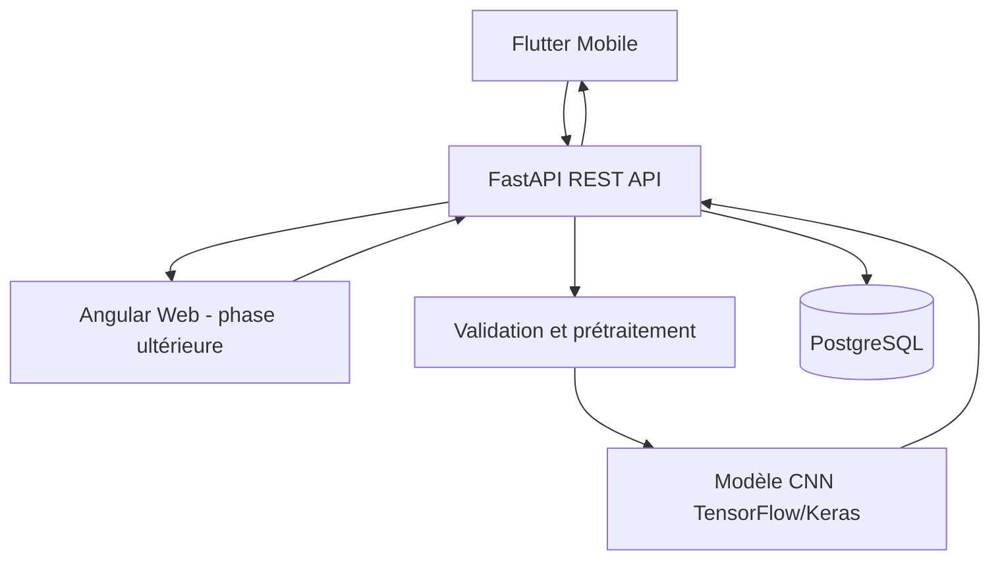

# Architecture — AgriScan AI

## 1. Vue d'ensemble

Le client mobile Flutter et, plus tard, le tableau de bord Angular communiquent avec un backend FastAPI via HTTPS. Le backend valide les images et exécute le modèle TensorFlow/Keras. PostgreSQL conserve les métadonnées autorisées, pas nécessairement les fichiers images eux-mêmes.

## 2. Responsabilités

### Client Flutter
- Capture ou sélection d'image.
- Validation préliminaire de taille et format.
- Appel HTTP à l'API.
- Affichage du résultat, des erreurs et de l'historique.
- Gestion des langues et du RTL.

### Client Angular
- Tableau de bord administratif ou utilisateur.
- Consultation des statistiques autorisées.
- Gestion des classes et versions si une fonction d'administration est définie.
- À reporter jusqu'à validation du parcours mobile/API.

### Backend FastAPI
- Contrôle des entrées et limites de taille.
- Décodage sécurisé et prétraitement.
- Inférence et application de la politique d'incertitude.
- Authentification et autorisation.
- Persistance des métadonnées.
- Journalisation sans secrets ni données sensibles inutiles.

### Module ML
- Chargement d'un modèle versionné.
- Prétraitement identique à celui de l'entraînement.
- Mapping explicite entre indices et labels.
- Inférence et production des scores.
- Tests de compatibilité du modèle.

### PostgreSQL
- Comptes utilisateurs et rôles.
- Métadonnées des analyses.
- Références de versions de modèles.
- Dates de création et suppression, selon les besoins retenus.

## 3. Décisions d'architecture

### D1 — Inférence initiale côté serveur
Le modèle est exécuté dans le backend pour simplifier sa mise à jour et son évaluation. Cela exige une connexion réseau et des ressources serveur.

### D2 — MobileNetV2 comme candidat, pas comme choix définitif
Comparer MobileNetV2 à une baseline simple sur le même protocole d'évaluation. Choisir sur la base de résultats mesurés, de robustesse et du coût d'inférence.

### D3 — API REST
L'API sépare l'interface utilisateur du modèle et permet plusieurs clients.

### D4 — Éviter la complexité prématurée
Ne pas ajouter Kubernetes, microservices, file de messages ou services payants avant d'avoir un besoin mesuré.

## 4. Flux d'une prédiction

1. Le client sélectionne une image.
2. L'image est envoyée à l'API.
3. Le backend contrôle taille, format et décodage.
4. Le prétraitement applique les transformations attendues par le modèle.
5. Le modèle calcule les scores des classes connues.
6. La politique de décision renvoie une prédiction ou un statut incertain.
7. L'API renvoie une réponse versionnée.
8. Les métadonnées sont enregistrées uniquement si cela est nécessaire et autorisé.

## 5. Versions et compatibilité

Chaque modèle doit être associé à :
- une version ;
- une liste de classes ;
- une configuration de prétraitement ;
- des métriques d'évaluation ;
- une date et une provenance ;
- les versions de dépendances importantes.

Une mise à jour du modèle ne doit pas modifier silencieusement l'interprétation des analyses historiques.

## Documents liés

- [Project Context](PROJECT_CONTEXT.md)
- [Requirements](REQUIREMENTS.md)
- [Dataset Card](DATASET_CARD.md)
- [Model Card](MODEL_CARD.md)
- [API Specification](API_SPECIFICATION.md)
- [Database](DATABASE.md)
- [Security](SECURITY.md)
- [Roadmap](ROADMAP.md)
